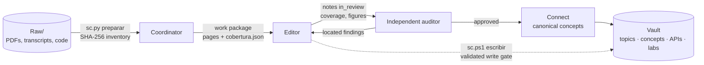

# Second brain

A multi-agent system that turns university lectures (slides, PDFs, lecture transcripts and lab code) into Obsidian study notes you can trust without re-checking them against the source.

I built it because LLM summaries of my courses kept failing in the same ways. They dropped definitions that appeared once in a list. They invented steps in proofs. They merged two different concepts that happened to share a name, and there was no way to tell which page a claim came from. Using a bigger model didn't fix it. What fixed it was building a harness around the model.

**[Live demo →](https://liiiaamm.github.io/second-brain/)** Step through one batch of lecture pages as it goes from `Raw/` to a validated note.

This repo is that harness: the roles, contracts, workflows, templates and Obsidian setup. My own course notes and the lecturers' material are not included.

## How it works



- **The coordinator** splits each source into packages of whole teaching units and assigns exclusive write access to each output. It never hands every manual to every agent.
- **The editor** reads every page of its package, including the images, and writes one note per teaching unit. Every page must end up *integrated*, *excluded with a reason* or *blocked* in `cobertura.json`. "Pending" never counts as done.
- **The auditor** never wrote the note it reviews. It gets the originals, not the editor's summary, compares formulas and figures visually, and returns findings with file, section, severity and expected fix. It does not rewrite notes.
- **Connect** keeps one canonical card per concept, with one owner per proof, so knowledge links up across subjects instead of being copied into each one.
- **The write gate** (`sc.ps1 escribir`) rejects broken LaTeX, dead links and missing anchors before anything touches a note. It also refuses a replacement under 90% of the original size unless a cut was declared, so content cannot be lost silently.

A note only becomes `validated` after an independent audit and a check of the rendered view. Passing the automatic checks proves structure, not quality, and the system says so wherever it matters.

## Ideas worth stealing

- **[Placing knowledge](Vault/_system/Placing%20knowledge.md).** The same idea can appear as a topic, a concept, an API card, a pattern or a lab note, and each one answers a different question. The [Softmax](Vault/Concepts/Softmax.md) / [torch.softmax](Vault/Implementations/PyTorch/torch.softmax.md) pair shows the split.
- **[Ontology and proofs](Vault/_system/Ontology%20and%20proofs.md).** Candidate, unit, result, route and appearance are kept as separate things. Two proofs of the same theorem stay separate because they are different routes. The lecturer's route is kept step by step and never swapped for an "equivalent" one.
- **[Transcripts](Vault/_system/roles/Transcripts.md).** Speech-recognition fixes come with a confidence level and evidence. A documented cut is kept apart from a suspected jump, and the system never makes up what wasn't recorded. Exam announcements are never discarded as noise.
- **[Conversations](Vault/_system/roles/Conversations.md).** When a chat goes into the vault, only the points that were hard to understand *and* got resolved are written up, not the whole transcript.
- **[Kev routing](Vault/_system/Kev%20routing.md).** An optional local decision model ([Kev](https://github.com/jaredpalmer/kev)) gives a second opinion on routing. Its votes are evaluated on held-out labels before anyone trusts them, and they never close, merge or delete anything on their own.

## Layout

```text
AGENTS.md            pointer for any agent harness
MAP.md               workspace map
Code/Tools/          the sc.py toolkit (documented in Vault/_system/Tools.md)
Vault/               open this folder in Obsidian
  _system/           RUN.md, architecture, contracts, editorial design, 10 roles, 1 skill
  _templates/        14 templates: topic, concept, API, pattern, lab, source, session, audit…
  _indices/          Obsidian Bases over note properties
  Concepts/ Implementations/ Subjects/
```

## Using it

1. Clone the repo and open `Vault/` in Obsidian. The `second-brain` CSS snippet is already enabled; if it doesn't show, reload it under Settings → Appearance → CSS snippets.
2. Create `Vault/Subjects/<Subject>/Raw/` and drop the originals in.
3. Open the folder in your agent harness and paste one of the [new task prompts](Vault/_system/New%20task%20prompts.md), for example *"Process [subject] in offline mode following AGENTS.md and Vault/_system/RUN.md…"*.

It works with whatever model and effort you choose. Roles are responsibilities, not separate processes: on a small batch one agent edits and another audits.

## Status

These are the instructions, contracts and templates I run every week. The `sc.py` toolkit they refer to isn't published yet; [Tools](Vault/_system/Tools.md) documents every command and what it guarantees.
